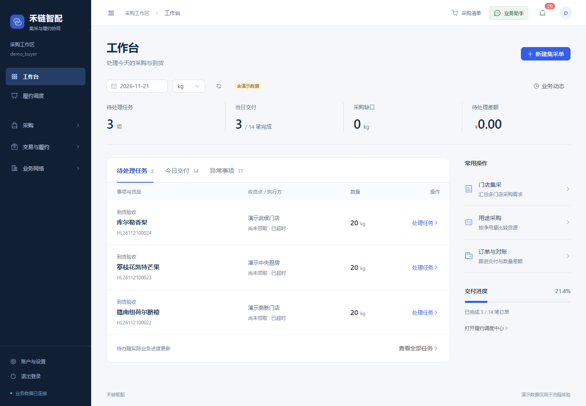
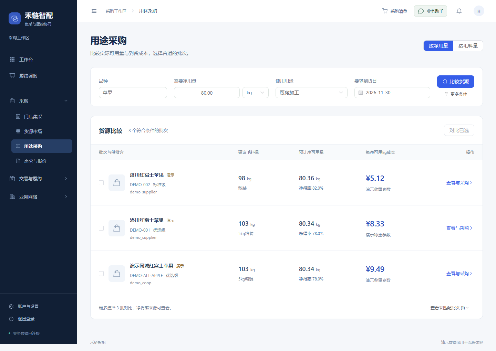
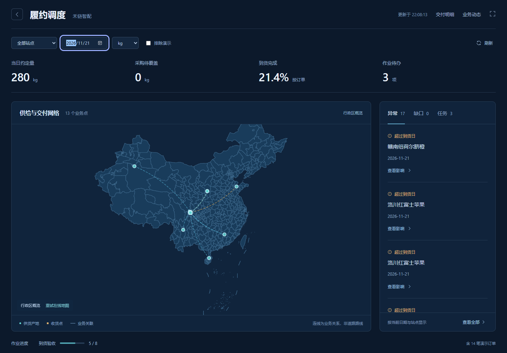

# 禾链智配 · 果蔬集采与履约调度

面向合作社、集配中心、连锁门店和中央厨房的采购与交付协同系统。采购、供应、协作供货和运营使用同一组需求、批次、订单、任务和验收记录。

**Vue 3 / Vite / Element Plus / Pinia / ECharts / Leaflet · Django REST Framework / MySQL · SciPy HiGHS MILP**

[快速启动](#快速启动) · [系统架构](docs/ARCHITECTURE.md) · [操作指南](docs/USER_GUIDE.md) · [开发约定](CONTRIBUTING.md) · [第三方说明](THIRD_PARTY_NOTICES.md)

## 主要能力

| 场景 | 当前实现 |
| --- | --- |
| 多门店集采 | 多品项、多收货点、截单时间、CSV 草稿导入、模板复用，报价与订单关联同一采购单 |
| 用途与净量采购 | 按批次、用途和加工方式保存称重依据，反算毛料量，比较到货成本与净可用成本 |
| 分级与库存 | 父子批次、分级价格、实际损耗、预留与释放；分级数量守恒，子批次待复核 |
| 实际履约 | 领取/阻塞/完成作业、二维码标签、分批发运、毛皮净称重、允差、合格与拒收 |
| 异常补配 | 保留未受影响安排，比较少改动/低费用/早交付；采购与供货方共同确认，替代方实际发运 |
| 对账与售后 | 实重尾差、异议补充依据、实际付款/退款凭证、独立补发验收、退货隔离入库 |
| 品质与运营 | 分项抽检与复检任务、采购影响排序、企业及岗位范围、可下钻统计、设备观测入口 |
| 调度地图与助手 | 日期/站点/单位联动、官方底图代理及行政区回退；本地采购字段抽取、可选外部解读 |

净得率依据区分整批实称、样本估算和演示参数；图像目标数量不等于重量损耗。MILP、Wilson 区间属于已有方法，项目不宣称原创统计方法或固定收益提升。

## 页面预览

截图为明确标识的历史演示业务，非真实库存或交易；日期筛选与记录到货日一致。





## 工程组织

| 路径 | 职责 |
| --- | --- |
| `code/Agricultural-product-system/` | 前端应用；`src/router` 路由、`stores` 状态、`views/workspace` 当前业务页面、`components` 共享组件 |
| `code/system/backend_system/` | Django 环境配置及 HTTP 入口 |
| `code/system/api/` | 业务 API、权限、规则、调度、库存、履约及结算；模块分工见架构文档 |
| `code/system/api/migrations/` | 完整结构迁移历史；新环境从空库迁移，已有环境增量迁移 |
| `code/system/api/management/commands/` | 三组演示初始化、独立到期任务 |
| `scripts/` | 可复现业务检查、显式设备模拟器 |
| `docs/` | 当前架构、操作指南与页面截图 |
| `vendor/` | 保留来源与许可证的第三方源码 |
| `docs/ci/github-actions.yml` | 可启用的前端构建、后端隔离业务检查 CI 模板 |

保留原有前后端路径，避免破坏现有启动、模型路径与本地环境。旧 Vue 外壳、未引用页面和重复状态模块已移除；后端仍被路由引用的兼容入口转交统一业务服务。数据库迁移和第三方许可不作为“旧文件”删除。

## 快速启动

### 环境与依赖

- Python 3.12；Node.js 20.19+ 或 22.12+（CI 模板使用 Node 24）；MySQL 8.0.11+。
- 交易、调度与人工质检不依赖地图密钥、外部大模型或图像权重。

```sh
git clone https://github.com/Felix-lxx/helian-smart-supply.git
cd helian-smart-supply
python -m venv .venv
```

Windows PowerShell：

```powershell
.\.venv\Scripts\python.exe -m pip install -r requirements.txt
Copy-Item code\system\.env.example code\system\.env
Set-Location code\Agricultural-product-system
npm ci
Set-Location ..\..
```

macOS / Linux：

```sh
.venv/bin/python -m pip install -r requirements.txt
cp code/system/.env.example code/system/.env
cd code/Agricultural-product-system
npm ci
cd ../..
```

### 数据库与配置

在本机 MySQL 创建 `utf8mb4` 空数据库及专用账号，将密码占位符替换为自己的密码：

```sql
CREATE DATABASE agri_db CHARACTER SET utf8mb4 COLLATE utf8mb4_unicode_ci;
CREATE USER 'agri_app'@'127.0.0.1' IDENTIFIED BY 'REPLACE_WITH_YOUR_PASSWORD';
GRANT ALL PRIVILEGES ON agri_db.* TO 'agri_app'@'127.0.0.1';
```

编辑 `code/system/.env`，配置 `DB_NAME`、`DB_USER`、`DB_PASSWORD`、`DB_HOST`、`DB_PORT`。开发环境设置 `DJANGO_DEBUG=true`，可留空 `DJANGO_SECRET_KEY` 让系统生成被忽略的本地开发密钥；非开发环境必须配置独立密钥。环境变量优先于 `.env`。

前端默认请求 `http://127.0.0.1:8000/api`。需要其他地址时，将前端 `.env.example` 复制为 `.env.local`，修改公开配置 `VITE_API_BASE_URL`；同域部署可设为 `/api` 并配置反向代理。`VITE_*` 会进入浏览器构建产物，不能存放密钥。

### 启动

Windows 根目录执行：

```powershell
powershell -ExecutionPolicy Bypass -File .\启动系统.ps1 -SeedDemo
```

脚本执行迁移及三组演示初始化，后台启动前后端与到期任务；日志在 `.run/`。MySQL 需提前启动。日常启动省略 `-SeedDemo`，已有监听端口会保留。

手动启动（先激活虚拟环境：Windows 为 `.\.venv\Scripts\Activate.ps1`，macOS/Linux 为 `source .venv/bin/activate`）：

```sh
cd code/system
python manage.py migrate
python manage.py seed_workspace
python manage.py seed_collaboration
python manage.py seed_dispatch
python manage.py runserver 127.0.0.1:8000 --noreload
```

另开终端，在后端目录运行：

```sh
python manage.py workspace_jobs --interval 45
```

另开终端，在前端目录运行：

```sh
npm run dev -- --host 127.0.0.1 --port 5173 --strictPort
```

打开 [本地系统](http://127.0.0.1:5173)。后端地址为 `http://127.0.0.1:8000`。

## 演示与配置边界

登录页提供采购端 `demo_buyer`、供应端 `demo_supplier`、协作供货方 `demo_coop` 和运营端 `demo_admin`，本地演示密码均为 `Demo@2026`。快捷登录只在 DEBUG 模式开放；正式环境不初始化演示账号。种子命令补齐缺失记录，不刷新已操作记录的日期与结果。查看历史演示时，选择对应到货日期。

| 后端配置 | 用途与缺省行为 |
| --- | --- |
| `TIANDITU_API_KEY` / `MAP_CLIENT_ORIGIN` | 天地图代理；未配置或不可用时显示行政区概览 |
| `DEEPSEEK_API_KEY` / `DEEPSEEK_BASE_URL` | 用户逐次同意后的外部解读；未配置时保留本地字段抽取与摘要 |
| `DEVICE_INGEST_TOKEN` | 设备上报授权；未配置时拒绝未授权上报 |
| `GEE_PROJECT` 等 | 可选遥感集成；缺失值保留不可用状态 |

所有后端字段见 [配置模板](code/system/.env.example)。地图虚线仅表示业务关系，当前未接实时车辆定位或导航。支付、退款与补款记录实际凭证及双方确认，不自动划款。设备模拟器见 `scripts/device_simulator.py`，只上报明确标识的随机 MOCK 数据。

可选图像推理：安装 `requirements-ai.txt`，自行准备有权使用的兼容 YOLOv5 权重至 `code/system/best.pt`。无权重或依赖时图像接口返回不可用，人工质检仍可操作；推理结果需要人工复核。生产部署还需配置 HTTPS、认证及媒体访问控制，不直接使用开发服务器。

## 检查与协作

[GitHub Actions 模板](docs/ci/github-actions.yml)已提供前端构建和后端隔离业务检查。当前发布凭据只有仓库写入权限，没有 `workflow` 授权，因此模板尚未写入 `.github/workflows/`，没有自动触发 CI；仓库所有者可将模板复制到该目录后启用。

根目录运行隔离业务检查（内存 SQLite，不修改 MySQL）：

```sh
python scripts/check_backend.py
```

该检查覆盖从空库迁移、三组演示种子、角色数据范围、净量报价、分级守恒、实际发运验收、实重异议及退款、独立补发验收、跨供货方补配。SQLite 检查不替代 MySQL 环境验证。

前端检查：

```sh
cd code/Agricultural-product-system
npm ci
npm run build
```

配置/结构发生变化时，在后端目录执行 `python manage.py check` 和 `python manage.py makemigrations --check --dry-run`。开发分工、提交及清理约定见 [CONTRIBUTING.md](CONTRIBUTING.md)。

## 发布与许可

`.env`、运行日志、个人/业务上传、数据库导出、权重、训练数据、安装包、虚拟环境和 `node_modules` 不进入仓库；数据库由迁移和明确标识的种子数据建立。历史实现可通过 Git 历史查看。

第三方来源与许可见 [THIRD_PARTY_NOTICES.md](THIRD_PARTY_NOTICES.md)。保留 Geeker-Admin MIT、YOLOv5 AGPL-3.0 等原有许可证；本项目未重新授权第三方内容，也未为原项目整体新增许可证。
