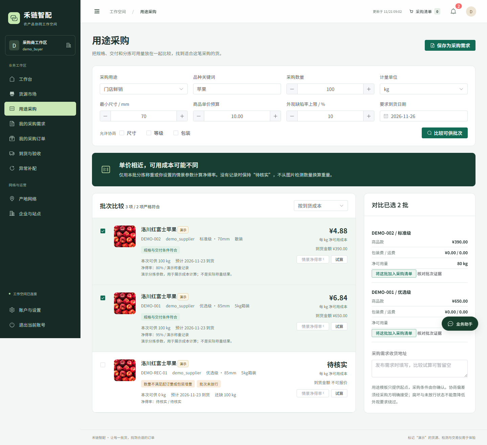
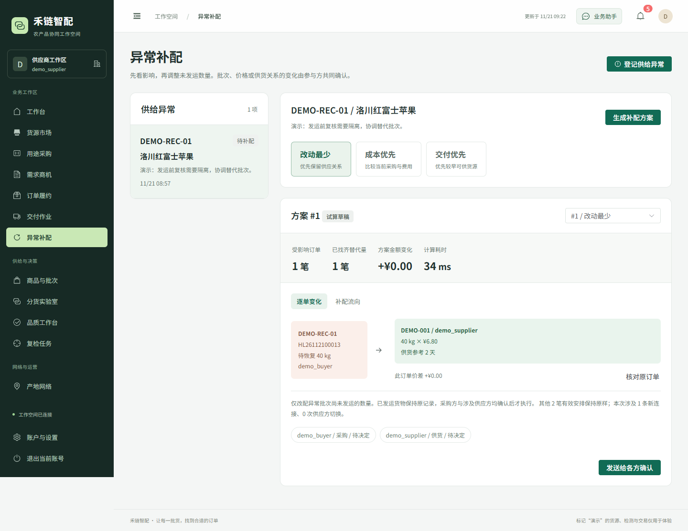

# 禾链智配 · 农产品采购与履约协同系统

面向合作社、集配中心、连锁门店和中央厨房的果蔬采购系统。围绕「按用途买得合适、批次异常后补得上、复检结果能影响交易」建设采购、供应和运营三个相互联动的工作区。

**Vue 3 · Django REST Framework · MySQL · SciPy MILP · ECharts · Leaflet**

[功能与特色](#功能与特色) · [页面预览](#页面预览) · [快速启动](#快速启动) · [演示流程](#演示流程) · [配置与边界](#配置与边界) · [项目结构](#项目结构)

## 功能与特色

| 业务能力 | 已实现的行为 | 可视化与交互 |
| --- | --- | --- |
| 用途采购 | 门店鲜销、厨房加工、榨汁模板；规格、交期、预算和允许协商项；按批次比较到货成本及净可用成本 | 多批次并排比较、条件差异解释、情景净得率试算、直接加入采购清单 |
| 异常补配 | 隔离、短缺、延迟影响定位；保留未受影响承诺；改动最少、成本优先、交付优先三种方案 | 调整前后逐单比较、补配流向图、影响数量、费用差额、多方确认 |
| 复检协同 | 分指标抽样记录、Wilson 区间、按受影响需求与不确定性排序、任务执行和人工处置 | 批次证据、区间图、受影响需求与复检任务联动 |
| 交易闭环 | 需求 → 报价 → 核价 → 下单 → 收款核对 → 分批发运 → 验收 → 异常处理 | 服务端核价、报价偏差确认、数量与品质分开验收、状态时间线 |
| 库存作业 | 批次可售、预留、释放、实称、损耗、拆批、发运扣减；库存流水与版本检查 | 批次作业侧栏、数量守恒、影响预览和任务看板 |
| 运营协同 | 企业、站点、供应岗位授权、日期及演示数据筛选、完整记录聚合、到期任务 | 可下钻指标、岗位范围、提醒记录、设备与批次/任务关联 |
| 地图与助手 | 天地图服务端代理、供给与站点图层；本地采购字段抽取；可选 DeepSeek 解读 | 地图点选与列表联动、采购草稿、用户逐次同意的外部解读 |

**计算逻辑有依据，也有边界：**

- 净可用成本 =（商品款 + 包装费 + 运费）÷ 净可用重量。没有称重依据时显示待核实，情景参数明确标识；不从图片目标数量推断重量损耗。
- 分货使用混合整数规划，包含库存容量、需求、起订量、数量增量、阶梯价与费用。异常补配只重排受影响的未发运分配，方案执行前需各方确认。
- 复检优先级采用透明规则；Wilson 区间用于说明抽样不确定性。这里使用的是已有统计及求解方法，不宣称原创算法、固定收益或食品安全认证。

## 页面预览

以下为本地演示数据截图，不代表真实库存、检测或交易。

### 用途采购与净可用成本



### 异常补配与多方确认



## 快速启动

### 1. 环境要求

- Python **3.12**，Node.js **20.19+ 或 22.12+**（以 `package.json` 的 engines 为准）。
- 本机运行 MySQL 8.0.11+，创建专用数据库与账号，使用 `utf8mb4`；版本要求见 [Django 数据库文档](https://docs.djangoproject.com/en/5.2/ref/databases/#version-support)。
- 交易、分货与人工质检流程不需要 DeepSeek、地图密钥或模型权重。图像推理需要另行准备可合法使用的权重和可选依赖。

### 2. 克隆与安装

```sh
git clone https://github.com/Felix-lxx/helian-smart-supply.git
cd helian-smart-supply
python -m venv .venv
```

Windows PowerShell：

```powershell
.\.venv\Scripts\python.exe -m pip install -r requirements.txt
Copy-Item code\system\.env.example code\system\.env
cd code\Agricultural-product-system
npm ci
cd ..\..
```

macOS / Linux：

```sh
.venv/bin/python -m pip install -r requirements.txt
cp code/system/.env.example code/system/.env
cd code/Agricultural-product-system
npm ci
cd ../..
```

### 3. 数据库配置

使用 MySQL 管理账号创建数据库及**仅针对该库**的应用账号。下面的密码是示例占位符，执行前必须替换：

```sql
CREATE DATABASE agri_db CHARACTER SET utf8mb4 COLLATE utf8mb4_unicode_ci;
CREATE USER 'agri_app'@'127.0.0.1' IDENTIFIED BY 'REPLACE_WITH_YOUR_LOCAL_PASSWORD';
GRANT ALL PRIVILEGES ON agri_db.* TO 'agri_app'@'127.0.0.1';
```

编辑 `code/system/.env`：

```dotenv
DJANGO_DEBUG=true
DB_NAME=agri_db
DB_USER=agri_app
DB_PASSWORD=REPLACE_WITH_YOUR_LOCAL_PASSWORD
DB_HOST=127.0.0.1
DB_PORT=3306
```

开发模式下可留空 `DJANGO_SECRET_KEY`，后端会生成并保存到被忽略的 `.django-dev-secret`。非开发模式必须设置独立密钥。环境变量优先于 `.env`。

### 4. 初始化与启动

Windows 可在根目录执行：

```powershell
powershell -ExecutionPolicy Bypass -File .\启动系统.ps1 -SeedDemo
```

脚本会执行迁移、补齐演示数据，并在后台启动前端、后端与到期任务。MySQL 需提前运行；日志保存在 `.run/`。日常启动省略 `-SeedDemo`，已有监听端口会保留。

也可以手动启动。先激活虚拟环境：Windows PowerShell 使用 `.\.venv\Scripts\Activate.ps1`，macOS / Linux 使用 `source .venv/bin/activate`；随后在 `code/system/` 中执行：

```sh
python manage.py migrate
python manage.py seed_workspace
python manage.py seed_collaboration
python manage.py runserver 127.0.0.1:8000 --noreload
```

在同一后端目录另开已激活虚拟环境的终端，运行到期任务：

```sh
python manage.py workspace_jobs --interval 45
```

在前端目录另开终端：

```sh
npm run dev -- --host 127.0.0.1 --port 5173 --strictPort
```

打开 **<http://127.0.0.1:5173>**，后端为 <http://127.0.0.1:8000>。当前前端默认请求本机 8000 端口；远程部署时需修改 `src/utils/request.js` 并配置域名和反向代理。

## 演示流程

登录页提供三种演示工作区。以下账号仅用于本地演示；生产环境不要初始化这些账号。演示数据脚本只补齐缺失记录，不重置已操作记录。

| 身份 | 账号 | 密码 |
| --- | --- | --- |
| 采购 | `demo_buyer` | `Demo@2026` |
| 供应 | `demo_supplier` | `Demo@2026` |
| 运营 | `demo_admin` | `Demo@2026` |
| 第二供应主体 | `demo_coop` | `Demo@2026` |

建议按三条业务链体验：

1. **用途采购**：采购端 `/procurement` 切换用途、数量和条件，比较净可用成本，加入清单并核价下单；供应端核对付款、分批发运，采购端逐次验收。
2. **异常补配**：供应端 `/recovery` 打开演示隔离批次，计算方案并发送；采购端打开同一方案确认，参与方全部确认后更新履约批次和库存预留。发生价差时会形成独立处理单。
3. **品质异常**：供应端 `/reviews` 创建/执行复检；采购端在订单验收中登记足量但品质不符，双方通过结构化补发、折让或退款处理单完成核对。

可同时使用两个浏览器或无痕窗口体验不同角色。工作区会周期同步，编辑中的质检草稿不会被刷新直接覆盖。

## 配置与边界

所有配置位于后端 `code/system/.env`，完整字段见 [`.env.example`](code/system/.env.example)。不要将凭据写进前端或 `VITE_*` 构建变量。

| 配置 | 用途 | 未配置时 |
| --- | --- | --- |
| `DEEPSEEK_API_KEY` / `DEEPSEEK_BASE_URL` | 可选语言模型解读 | 保留本地字段抽取与工作区摘要 |
| `TIANDITU_API_KEY` / `MAP_CLIENT_ORIGIN` | 官方底图与标注，后端代理请求 | 可使用离线产地概览 |
| `DEVICE_INGEST_TOKEN` | 设备上报令牌 | 拒绝未授权设备上报 |
| `GEE_PROJECT` 等 | 可选 Earth Engine 遥感集成 | 缺失指标显示不可用 |
| `DJANGO_DEBUG` / `DJANGO_SECRET_KEY` | 开发模式与签名密钥 | 默认关闭 DEBUG；非开发模式缺密钥拒绝启动 |

- 助手默认本地处理；仅用户针对本次消息勾选同意后，才会将问题和工作区统计发送至 DeepSeek。
- 地图坐标使用 WGS84/CGCS2000，经度在前、纬度在后；未知坐标不补造。行政区域演示点不代表真实经营地址。当前没有实时车辆定位或道路配送导航。
- 支付、退款及补款以双方登记实际凭证并核对为准，未接支付网关，不自动划转资金。
- 图片模型输出需人工复核，不自动放行库存。设备模拟脚本明确标注 MOCK，不代表真实硬件结果。
- 本仓库是开发与演示项目。正式部署需关闭 DEBUG、移除演示账号、配置 HTTPS、完善认证/CSRF 策略和媒体访问控制，并进行独立部署审查。

### 可选图像识别

默认安装只覆盖采购、履约、分货与人工检查。需要 YOLO 图像推理时：

```sh
python -m pip install -r requirements-ai.txt
```

将**自行准备且有权使用**的兼容 YOLOv5 权重放到 `code/system/best.pt`。仓库包含原有本地 YOLOv5 源码及其许可证，不包含训练数据和权重。没有权重或依赖时，图像接口明确返回不可用，人工检查与交易流程继续工作。CUDA 环境按设备选择匹配的 PyTorch 安装方式。

## 项目结构

| 路径 | 内容 |
| --- | --- |
| `code/Agricultural-product-system/` | Vue 前端，当前业务位于 `src/views/workspace/` |
| `code/system/api/commerce.py` | 工作区、商品、需求、报价、订单、助手入口 |
| `code/system/api/commerce_rules.py` | 适配、核价、库存与需求恢复规则 |
| `code/system/api/decisions.py` | 分货与最小改动补配求解 |
| `code/system/api/workflow.py` | 分批发运、验收、结构化异常处理 |
| `code/system/api/collaboration_api.py` | 用途比较、检查、补配、企业站点 API |
| `code/system/api/reporting.py` | 完整记录统计 |
| `code/system/api/map_api.py` | 固定官方地图服务代理 |
| `code/system/api/migrations/` | 数据库结构历史，从空库执行迁移 |
| `code/system/api/management/commands/` | 演示初始化与独立到期任务 |
| `vendor/yolov5/` | 原有第三方 YOLOv5 源码与许可证 |
| `code/mock_x5.py` | 显式模拟的设备上报脚本 |
| `docs/` | 研究计划、分轮交付说明与演示截图 |
| `requirements*.txt` | 基础 / 可选图像推理依赖 |
| `启动系统.ps1` | Windows 本地启动脚本 |

旧 Vue 页面和兼容接口保留作历史兼容，当前功能以工作区路由为准；旧研究计划不等于全部已实现功能。

## 验证与文档

```powershell
# 根目录：后端配置与迁移一致性
cd code\system
..\..\.venv\Scripts\python.exe manage.py check
..\..\.venv\Scripts\python.exe manage.py makemigrations --check --dry-run

# 前端构建
cd ..\Agricultural-product-system
npm run build
```

已有关键业务流程及桌面/手机浏览器检查记录见[本轮交付说明](docs/系统升级交付说明_2026-11-21.md)。本次公开整理还检查了前端构建、迁移一致性，以及禁用可选 AI 依赖时的空库迁移、两组演示初始化和采购工作区接口。空库检查使用内存 SQLite，不等同于所有 MySQL 版本的完整验证。本地临时测试日志未作为可复现测试套件发布。

## 发布内容与第三方说明

仓库不包含 `.env`、个人/业务媒体文件、数据库导出、模型权重、训练数据、安装包、运行日志、虚拟环境或 `node_modules`。这些文件留在本机，由 `.gitignore` 排除；数据库通过 migrations 建立，演示数据通过管理命令生成。

第三方代码及许可证见 [THIRD_PARTY_NOTICES.md](THIRD_PARTY_NOTICES.md)。公开仓库不表示可忽略第三方许可，尤其需要遵守 YOLOv5 的 AGPL-3.0 条款；本次整理没有为原项目整体重新授权。
