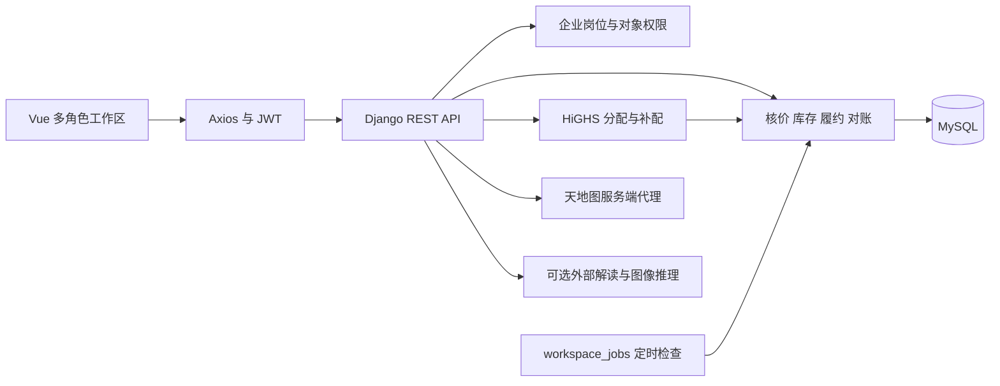
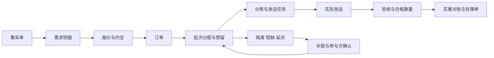

# 系统架构与模块边界

当前采用 Vue 单页应用与 Django 模块化单体；采购、供应、协作供货及运营由角色和企业岗位范围区分，共用业务对象。没有独立微服务、消息队列或真实车辆定位服务。

## 前端

- `main.js` / `App.vue`：应用装配和全局样式。
- `router/index.js`：唯一页面路由入口；旧地址重定向到当前工作区。
- `views/WorkspaceShell.vue`：分组导航、角色上下文、消息与页面容器。
- `views/workspace/`：按业务场景组织页面，不复制一套买方/卖方数据模型。
- `stores/workspace.js`：工作区快照、采购清单、共享动作与刷新。
- `composables/useBusinessFeed.js`：页面同步、加载与错误状态。当前使用周期刷新与操作事件刷新，不是 WebSocket 推送。
- `components/`：地图、图表、库存作业、处理单、状态标签及助手。
- `utils/request.js`：公开后端地址、JWT 请求及过期登录处理。

## 后端

| 模块 | 职责 |
| --- | --- |
| `commerce.py` | 交易入口、数据序列化、商品/需求/报价/订单、工作区与业务事件 |
| `fulfilment_api.py` | 集采单、用途称重、分级、作业任务、完整分页、实重及供货对账、大屏聚合 |
| `commerce_rules.py` | 统一适配、核价、库存流水、预留和需求恢复 |
| `coordination.py` | 作业任务同步、用途依据、净量反算与实重差额 |
| `transport.py` | 实际发运、称重、分批验收和履约状态汇总 |
| `workflow.py` | 异常处理方案、凭证执行、补发与退货确认 |
| `decisions.py` | 分配、库存情景、异常补配及确认执行 |
| `collaboration_api.py` | 抽检复检、供给异常、方案确认、企业岗位与站点 |
| `access.py` | 企业岗位授权和采购/供货主体范围 |
| `reporting.py` | 完整业务记录聚合与资金口径 |
| `workspace_jobs.py` | 预留、报价到期与交期提醒；独立管理命令循环运行 |
| `map_api.py` | 固定官方瓦片代理、缓存与服务异常退避 |
| `views.py` / `serializers.py` | 认证、用户资料等通用接口及仍被引用的兼容入口 |
| `models.py` / `migrations/` | 共享业务对象与不可随意删除的结构历史 |

## 业务关系

涉及库存、订单和方案执行的动作在服务端事务中检查权限、状态、版本及数量；图表和助手不直接绕过业务入口写库。价格与验收约定保留快照；补配区分原交易责任方、实际履约方及对应供货结算。

## 配置及发布

基础依赖与可选推理依赖分离。后端机密来自环境变量或被忽略的 `.env`；前端只有公开 API 地址。第三方源码保存在 `vendor/`，维护来源和许可证，不按普通孤立文件推断其动态依赖。

生产环境由使用者准备 MySQL、HTTPS 反向代理、WSGI/ASGI 服务和到期任务进程；本仓库提供开发启动与 CI 检查，不声称已经完成生产部署。
